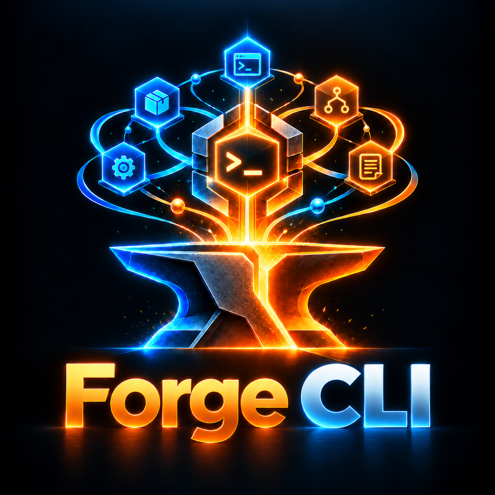

<p align="center">
  
</p>

# Forge-CLI

CLI interativa para clonar e configurar o ecossistema **Forge**: oito
repositórios, um comando. O forge-cli resolve o diretório de destino,
sincroniza cada repositório (clone ou pull), provisiona o arquivo `.env`
e executa o script de instalação do sistema operacional — tudo com
feedback visual em tempo real.

## Funcionalidades

- **Fluxo 100% interativo** com `@clack/prompts`: banner animado,
  prompts, spinners com cronômetro e relatório final consolidado.
- **Sincronização inteligente**: faz `git clone` quando o repositório
  não existe e `git pull` quando a pasta já contém `.git`.
- **Provisionamento de `.env`**: antes de qualquer script de
  instalação, copia `.env.example` para `.env` ou cria um modelo com
  comentários. Um `.env` existente nunca é sobrescrito.
- **Scripts por sistema operacional**: `install.ps1` no Windows e
  `install.sh` no Linux/macOS, detectados automaticamente.
- **Verificação de ambiente (preflight)**: confirma `git`, Node.js
  > = 20 e `powershell.exe` (Windows) antes de qualquer alteração.
- **Isolamento de falhas**: o erro em um repositório não interrompe os
  demais; o relatório final mostra `[OK]`, `[AVISO]` ou `[ERRO]` por
  item, com tempo de execução.
- **Saída limpa**: cancelamento via `Ctrl+C` em qualquer prompt
  ou `SIGINT` durante a execução.

## Requisitos

| Requisito       | Versão           | Observação                       |
| --------------- | ---------------- | -------------------------------- |
| Node.js         | >= 20            | Verificado no preflight          |
| npm             | >= 10            | Gerenciador de pacotes fixo      |
| Git             | qualquer recente | Precisa estar no `PATH`          |
| PowerShell      | qualquer         | Somente Windows — `install.ps1`  |
| Credenciais Git | —                | Acesso aos repositórios privados |

## Instalação

**Usuário final — via npm (recomendado):**

```bash
npm i -g theforge-cli   # pacote publicado — sem clone necessário
forge-cli               # TUI guiada
```

**Contribuidor — via clone:**

```bash
git clone https://github.com/EdgarSocrates98/forge-cli.git
cd forge-cli
npm install
npm run build
npm link        # registra o binário `forge-cli`
forge-cli       # em qualquer diretório
```

Alternativa sem npm global — o próprio CLI se registra no PATH do usuário
(sem admin), copiando o bundle para `~/.forge-cli/bin`:

```bash
npm run build
node dist/index.js self install  # Windows: forge-cli.cmd + PATH do usuário
                               # Linux/macOS: shim sh + bloco nos profiles
forge-cli self uninstall       # desfaz tudo (PATH, shims e bundle)
```

Após `self install`, abra um terminal novo — o PATH do usuário só é lido por
processos novos. `forge-cli doctor` avisa quando o binário não está
acessível no PATH.

## Quickstart

1. Instale o forge-cli (`npm run build && node dist/index.js self install` a partir do clone, ou `npm i -g theforge-cli` quando publicado).
2. Abra um terminal novo e rode `forge-cli`.
3. Escolha **Instalar Forjas**, selecione as Forjas desejadas e confirme.
4. Use os comandos oficiais de cada Forja (a seção "próximos passos" do relatório lista os principais).

Para atualizar o próprio CLI: `forge-cli self update` (npm global executa `npm i -g theforge-cli` com `--yes`; demais métodos mostram o passo manual).

## Instalador nativo (perfil, escopo, componentes)

```bash
forge-cli install spark-forge-aws --profile recommended --scope project --components skills,agents        # plano (--dry-run)
forge-cli install spark-forge-aws --profile recommended --scope project --components skills,agents --yes  # aplica
```

O forge-cli só delega ao `<cli> install` que a Forja documenta; Forjas sem
instalador nativo (ex.: forge-portal) recebem um aviso, sem substituto
silencioso. Veja [docs/capabilities.md](https://github.com/EdgarSocrates98/forge-cli/blob/v0.1.0/docs/capabilities.md).

## Instalação via PyPI (registry-first — método recomendado)

`forge-cli` sem argumentos abre a TUI guiada com **registry como opção
recomendada** para as distribuições oficiais. O método git (clone +
scripts) continua disponível para contribuidores — registry-first, não
registry-only. `install --method registry`
instala cada Forja direto do PyPI — sem clonar o repositório e sem
exigir o The Forge. Cada Forja vai para uma venv isolada em
`~/.forge-cli/forges/<nome>/` com `pip install <dist>==<versão>`
pinado na estável mais nova (ou `--version`/`--ref` para pinar, uma
Forja por comando). O interpretador escolhido é o mais novo que
satisfaz `requires_python` do release; sem compatível, o install é
recusado antes de qualquer mutação.

- `forge-cli registry` lista o catálogo (7 dists) e o instalado.
- Receipts em `install.json`/`state.json`: dist, versão, interpretador,
  digests sha256 e verify — o artefato da dist é conferido byte a byte
  após o download.
- `--offline` resolve do cache local (metadados em
  `~/.forge-cli/cache/pypi/`, wheels em `cache/wheels/<dist>/`);
  artefato ausente = recusa honesta, nunca instalação fingida.
- Releases yanked (PEP 592) são puladas na escolha automática; só
  instalam por pin explícito e ficam marcadas no receipt.
- `uninstall --method registry` remove venv + receipt com plano e
  confirmação (`--yes`); `--all`/`--only` resolvem o conjunto instalado.

## Independência

O forge-cli é uma conveniência opcional: nenhuma Forja depende dele e remover o CLI (`self uninstall`) não afeta Forjas já instaladas. Instalações feitas à mão são reconhecidas (`forge-cli status`) sem precisar reinstalar. Estes cenários estão cobertos em `tests/independence.test.ts`.

## Comandos

```bash
forge-cli install api-forge platform-forge   # instala Forjas escolhidas
forge-cli install                            # fluxo interativo
forge-cli clone api-forge                    # só clona/sincroniza, sem scripts
forge-cli status                             # estado local (clonado, versão, alterações)
forge-cli update [--check]                   # atualiza (ou só verifica) Forjas clonadas
forge-cli versions api-forge                 # revisão e tags
forge-cli install api-forge --version 1.2.0  # fixa em tag/sha (checkout destacado)
forge-cli install api-forge --method registry # instala do PyPI em venv isolada (~/.forge-cli/forges/)
forge-cli install --all --method registry     # todas as Forjas publicadas via PyPI
forge-cli registry                            # catálogo PyPI + instaladas (--json estrutura)
forge-cli uninstall api-forge --method registry --yes  # remove venv + receipt registry
forge-cli pin|unpin|rollback api-forge       # fixação e retorno ao HEAD anterior
forge-cli reinstall api-forge [--clean]      # mantém a revisão; --clean reclona com backup
forge-cli uninstall api-forge [--yes]        # plano + backup de .env/configs
forge-cli components [forjas]                # flags do instalador nativo por Forja
forge-cli doctor [forjas] [--fix]            # diagnostica (ou repara) Forjas
forge-cli install api-forge --offline        # só usa clone existente, sem rede
forge-cli update api-forge --native           # também a operação nativa (--dry-run sem --yes)
forge-cli uninstall api-forge --native --yes # desinstala nativamente e depois remove o clone
forge-cli status --json                      # saída estruturada (também list, versions, components, doctor)
forge-cli self install | self uninstall | self update
forge-cli help
```

Segurança: scripts não rodam após falha de sync (`--run-after-sync-failure`
libera) e repositórios de `forge-cli.repos.json` só executam scripts com
`--trust-custom`. `--yes` não autoriza o instalador nativo a escrever sem
que seja passado explicitamente.

> `forge-cli install` agora instala Forjas; o registro no PATH passou a
> ser `forge-cli self install`.

## Uso

Execute `npm run dev` (ou `forge-cli`, se instalado globalmente) e siga
o fluxo interativo:

1. **Banner e verificação de ambiente.** O CLI exibe o banner do Forge
   e valida `git`, a versão do Node.js e o `powershell.exe` (no
   Windows). Falhas encerram o processo antes de qualquer prompt.
2. **Diretório de instalação.** Informe onde os repositórios serão
   clonados. O padrão é `./forge-workspace`; o caminho é convertido
   para absoluto e o diretório criado se não existir.
3. **Seleção de repositórios.** Marque ou desmarque itens com `Espaço`.
   Todos os oito vêm selecionados por padrão; ao menos um é obrigatório.
4. **Confirmação.** Revise o resumo (destino e quantidade) e confirme.
5. **Execução.** Para cada repositório, um spinner mostra a fase atual:
   `Sincronizando`, `Provisionando .env` e `Executando script`.
6. **Relatório final.** Status por repositório com tempo de execução e
   totais agregados.

Para cancelar em qualquer etapa, pressione `Ctrl+C`. O processo
encerra de forma limpa (código `130` em `SIGINT`).

## Repositórios do ecossistema

| Repositório         | Descrição                        |
| ------------------- | -------------------------------- |
| `the-forge`         | Framework base e utilitários     |
| `spark-forge-aws`   | Pipelines Spark para AWS         |
| `spark-forge-azure` | Pipelines Spark para Azure       |
| `platform-forge`    | Serviços e infra de plataforma   |
| `api-forge`         | Backend central e APIs           |
| `forge-doctor-api`  | API de diagnóstico e telemetria  |
| `forge-doctor-data` | Pipeline de dados de diagnóstico |
| `forge-portal`      | Frontend / Portal Web            |

Todos os repositórios ficam na organização
[`EdgarSocrates98`](https://github.com/EdgarSocrates98) no GitHub.

## Provisionamento do `.env`

Antes do script de instalação, cada repositório recebe um `.env`:

| Condição              | Ação                          | Indicador no relatório                 |
| --------------------- | ----------------------------- | -------------------------------------- |
| `.env` já existe      | Nada — nunca sobrescreve      | `.env já existia`                      |
| `.env.example` existe | Copiado para `.env`           | `.env criado a partir de .env.example` |
| Nenhum dos dois       | Modelo com comentários criado | `.env criado (modelo vazio…)`          |

Se o provisionamento falhar (por exemplo, permissão negada), o
repositório é marcado como `[ERRO]` e o script de instalação **não**
é executado para ele.

## Status de execução

| Status       | Significado                                        |
| ------------ | -------------------------------------------------- |
| ✅ `[OK]`    | Clonado/atualizado e script executado com sucesso  |
| ⚠️ `[AVISO]` | Clonado, mas sem script de instalação para este SO |
| ❌ `[ERRO]`  | Falha no clone/pull, no `.env` ou no script        |

## Scripts do projeto

| Comando             | Ação                                   |
| ------------------- | -------------------------------------- |
| `npm run dev`       | Executa o CLI via `tsx`, sem compilar  |
| `npm run build`     | Compila `src/` para `dist/` via `tsup` |
| `npm start`         | Executa `dist/index.js`                |
| `npm test`          | Testes unitários via `vitest`          |
| `npm run typecheck` | Verificação de tipos (`tsc --noEmit`)  |

## Estrutura do projeto

```text
src/
  index.ts           # despacho: args, menu, subcomando
  cmd/               # implementação dos comandos (query, manage, run, batch, shared)
  prompts.ts         # prompts: diretório, seleção, confirmação
  menu.ts            # menu principal (TUI)
  commands.ts        # resolução de subcomandos
  safety.ts          # nomes/URLs seguros, symlinks, redação de segredos
  git-revs.ts        # tags, checkout por ref, update --check
  lifecycle.ts       # uninstall seguro, rollback
  native-install.ts  # adaptador do instalador nativo (profile/scope/components)
  status.ts          # estado local por Forja
  self.ts            # self update por método de instalação
  runner.ts          # pipeline por repositório (clone → .env → script)
  env.ts             # provisionamento do .env
  preflight.ts       # verificações de ambiente
  report.ts          # relatório final
  ui/
    theme.ts         # paleta de cores e ícones (picocolors)
    strings.ts       # todas as mensagens PT-BR
  constants/
    repos.ts         # catálogo dos 8 repositórios
  utils/
    system.ts        # caminhos, .git, scripts por SO, execução
  types.ts           # tipos compartilhados
tests/               # testes unitários (vitest)
factory/             # fluxo spec-driven (Loop Factory)
```

## Documentação

- [Arquitetura e decisões de design](https://github.com/EdgarSocrates98/forge-cli/blob/v0.1.0/docs/arquitetura.md)
- [Matriz de capacidades das Forjas](https://github.com/EdgarSocrates98/forge-cli/blob/v0.1.0/docs/capabilities.md)
- [Solução de problemas](https://github.com/EdgarSocrates98/forge-cli/blob/v0.1.0/docs/solucao-de-problemas.md)
- [Como contribuir](https://github.com/EdgarSocrates98/forge-cli/blob/v0.1.0/CONTRIBUTING.md)
- [Registro de mudanças](https://github.com/EdgarSocrates98/forge-cli/blob/v0.1.0/CHANGELOG.md)

## Licença

[MIT](https://github.com/EdgarSocrates98/forge-cli/blob/v0.1.0/LICENSE) © 2026 Edgar Sócrates Caria
