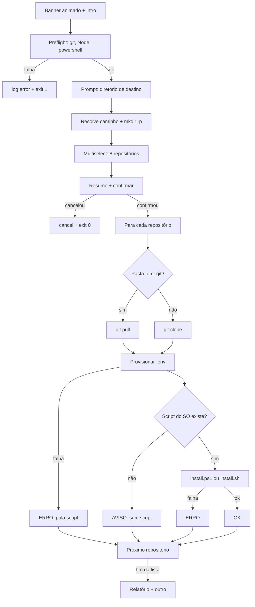

# Arquitetura

O forge-cli é um CLI Node.js (ESM + TypeScript) de fluxo único: um
orquestrador fino coordena módulos pequenos e testáveis. A regra de
organização é simples — **`src/index.ts` só orquestra; toda lógica
vive em módulos especializados.**

## Mapa de módulos

| Módulo | Responsabilidade |
|---|---|
| `src/index.ts` | Orquestra o fluxo: banner → preflight → prompts → execução → relatório. Trata `SIGINT` e erros fatais. |
| `src/prompts.ts` | Prompts interativos (diretório, seleção, confirmação) e tratamento de cancelamento via `isCancel()`. |
| `src/preflight.ts` | Verificações de ambiente antes de qualquer prompt: `git`, Node.js >= 20, `powershell.exe` no Windows. |
| `src/runner.ts` | Pipeline por repositório com cronômetro e fases: sincronizar → `.env` → script de instalação. |
| `src/env.ts` | Provisionamento do `.env` (`planEnvFile` decide, `ensureEnvFile` executa). |
| `src/report.ts` | Badges de status, linha por repositório e relatório consolidado. |
| `src/ui/theme.ts` | Paleta de cores (picocolors) e ícones emoji. Único ponto de contato com cores. |
| `src/ui/strings.ts` | Todas as strings visíveis ao usuário, em PT-BR. |
| `src/constants/repos.ts` | Catálogo fixo dos oito repositórios Forge. |
| `src/utils/system.ts` | Primitivas: resolução de caminho, `.git`, seleção de script por SO, `execa`, detalhe de erro. |
| `src/types.ts` | Tipos compartilhados (`ForgeRepo`, `RepoResult`, `InstallScript`, `PreflightCheck`). |

## Fluxo de execução



## Decisões de design

### `.env` antes do script de instalação

Os scripts `install.ps1`/`install.sh` presumem variáveis de ambiente.
O `runner` provisiona o `.env` entre a sincronização e o script: se o
provisionamento falhar, o script nem roda — falhar cedo evita
instalações parciais silenciosas.

### `.env` nunca é sobrescrito

`planEnvFile` retorna `exists` quando o `.env` já está presente. O
repo pode ter segredos reais configurados; o CLI só cria o arquivo
quando ele não existe. Esta regra é coberta por teste em
`tests/env.test.ts`.

### Preflight falha rápido

Ambiente sem `git` ou sem `powershell.exe` (Windows) não consegue
completar o fluxo. Melhor falhar com mensagem clara antes de criar
diretórios do que descobrir no meio do lote.

### Isolamento de erro por repositório

`processRepo` converte cada falha (clone, `.env`, script) em um
`RepoResult` com `status: 'error'` em vez de lançar exceção. O laço
continua e o relatório final mostra o quadro completo.

### Erro detalhado via execa

`errorDetail` extrai `stderr`, `shortMessage` ou `message` do erro do
`execa` — o relatório mostra a causa real (por exemplo, erro de
autenticação do git), não só "falhou".

### Strings e cores centralizadas

Todo texto PT-BR vive em `src/ui/strings.ts` e toda cor em
`src/ui/theme.ts`. Isso mantém o código livre de literais soltos e
abre caminho para i18n futura sem reescrever módulos.

## Tipos centrais

```typescript
interface ForgeRepo { name; url; description }
type RepoStatus = 'ok' | 'warning' | 'error';
type EnvAction = 'exists' | 'copied' | 'stub';
interface RepoResult { repo; status; detail; envNote?; elapsedMs }
interface InstallScript { file; command; args }
```

## Build e distribuição

- `tsup` compila `src/index.ts` para `dist/index.js` (ESM único,
  ~12 KB), preservando o shebang do binário.
- `bin.forge-cli` aponta para `dist/index.js`; `npm link` registra o
  comando global.
- Dependências ficam externas ao bundle e são instaladas via
  `package.json`.
